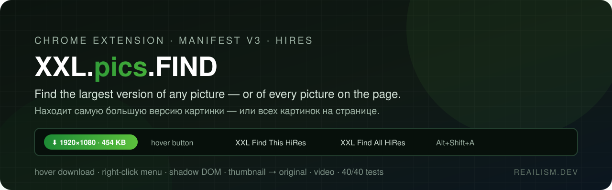
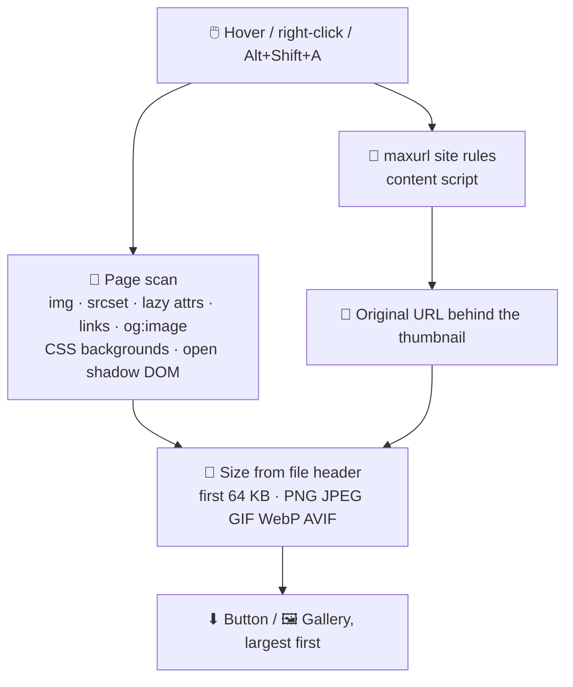

<div align="center">

> 🇷🇺 **Русская версия доступна ниже** — [перейти к русской документации ↓](#ru)



# ⚡ XXL.pics.FIND

**Find the largest version of any picture — or of every picture on the page.**


[**Install**](#️-install) · [**What it does**](#-what-it-does) · [**How it works**](#-how-it-works) · [**Tests**](#-tests) · [**Privacy**](#-privacy) · [**Русский**](#ru)

</div>

---

Sites show you a thumbnail and keep the real picture somewhere else: behind a `srcset`, a
lazy-load attribute, a link, a resizing URL, or inside a web component. **XXL.pics.FIND**
finds the biggest file for you, tells you its real pixel size **before** you download it,
and saves it in one click.

It is a Manifest V3 extension powered by the site rules of
[maxurl](https://github.com/qsniyg/maxurl) (thousands of sites).

## 🔥 Why you'll love it

| ❌ Without it | ✅ With XXL.pics.FIND |
|---|---|
| Right-click → "Save image as" gives you the 300 px thumbnail | **Hover button** offers the largest file: `⬇ 1920×1080 · 454 KB` |
| A gallery page has 60 pictures and you open them one by one | **`XXL Find All HiRes`** lists every picture on the page, largest first |
| Web components hide pictures from every scraper (Rotten Tomatoes: 61 of 65 `` in shadow DOM) | Open **shadow DOM** is walked too |
| A resizing URL wraps the original inside itself | The site rules **name the original**; it replaces the thumbnail in the gallery |
| Videos are blob streams you can't save | Video files and HLS/DASH playlists the page loads are **listed and ranked** |

## ✨ What it does

- 🟢 **Hover download button** — a green pill on pictures and videos under the mouse, only when
  a source file really exists. The size comes from the file header (first 64 KB), so nothing
  is downloaded in full to rank it. A switch in the popup turns it off.
- 🖱️ **Right-click menu, two flat lines**
  - `XXL Find This HiRes` — over a picture, video, audio or link: opens the larger file.
  - `XXL Find All HiRes` — anywhere else on the page: opens the gallery.
  - Also on **`Alt+Shift+A`** (change it on `chrome://extensions/shortcuts`) and as a button
    in the toolbar popup — that is how you reach it while the pointer is over a picture.
- 🖼️ **HiRes gallery** — nine cards at a time (`SHOW NEXT 9`), largest first, with a size
  filter. Each card has Open, Download and Copy URL.
- 🎬 **Video and streams** — `<video>` files, `.m3u8` / `.mpd` playlists (best variant is read),
  and the video variants X (x.com) returns. *The X part is only tested against a fixture in the
  shape yt-dlp documents, not against live x.com.*
- 🔐 **Pictures that need a Referer** open and download through the extension's own viewer.

**Why you need it.** Many sites show a small preview and hide the full picture in a link, a `srcset`,
a lazy-loading attribute or a web component. XXL.pics.FIND finds the largest version, shows its real size
before you download, and saves it in one click. Handy for designers collecting references, for film posters,
and for anyone who wants the original file.

## 🌐 Where it works

Checked by hand or with automated tests. Anything else is best effort: the extension runs on every page,
but how well it works depends on how the site hides its pictures.

| Site | Status | What was checked |
|---|---|---|
| Rotten Tomatoes, movie pictures page | ✅ Checked on the live site | The scan found about 130 pictures, largest first; the hover button showed the size of the full file |
| Test pages: `srcset`, lazy loading, `og:image`, CSS backgrounds, open shadow DOM | ✅ Automated tests | Run in a headless browser |
| X (x.com, formerly Twitter) | ⚠️ Not checked on the live site | Videos and original photos are read from X's own API responses. The parser is tested only on a sample in X's format, because X's login wall blocks automatic checks |
| Behance, Dribbble | ❓ Not checked yet | Both use lazy loading and `srcset`, which the extension reads, but nothing has been tested there |
| Pictures that need a `Referer` | ⚠️ Partly | The scan and the download work; the hover button cannot read the size of such pictures |
| Closed shadow DOM, pictures drawn on a canvas | ❌ Not reachable | No script can read them |


> About a minute. Works in Chrome 120+, Edge, Brave and Vivaldi (Chromium browsers). No account needed.

**1. Get the extension.** Download `XXL.pics.FIND-1.4.0.zip` from
[Releases](https://github.com/dobrdigital/XXL.pics.FIND/releases) and unzip it into a folder you will keep
(for example `DocumentsXXL.pics.FIND`). Chrome reads the files from that folder, so do not delete it.

**2. Load it in the browser.**

| Browser | Address to open | Turn on | Then |
|---|---|---|---|
| Chrome | `chrome://extensions` | **Developer mode** (top right) | **Load unpacked** → pick the unzipped folder |
| Edge | `edge://extensions` | **Developer mode** (left panel) | **Load unpacked** → pick the unzipped folder |
| Brave | `brave://extensions` | **Developer mode** (top right) | **Load unpacked** → pick the unzipped folder |
| Vivaldi | `vivaldi://extensions` | **Developer mode** (top right) | **Load unpacked** → pick the unzipped folder |

Chrome shows a warning that the extension "can't be reviewed by the Chrome Web Store" and that
developer mode is needed. That is expected for an extension loaded from a folder; it does not
mean the extension is unsafe. The warning is about where the code came from.

**3. Use it.** Hover a picture for the ⬇ button, right-click a picture for **XXL Find This HiRes**,
or press **Alt+Shift+A** (or the popup button) to list the largest pictures on the page.

**Updating:** unzip the new version over the old folder, then press the **Reload** button of the
extension on its page. Chrome does not pick up changed files on its own.

**From source (for developers):** `git clone https://github.com/dobrdigital/XXL.pics.FIND`, then load
the cloned folder the same way. `npm install`, `npm test` and `npm run package` are described below.

The extension id depends on the folder path, which is why the same extension may show a different id
on another computer. It does not matter for normal use.

## 🔍 How it works



- `background.js` is the service worker: a dispatch table for every message, a cross-origin
  request proxy using `declarativeNetRequest` session rules for headers, the page scan, and
  the network capture of video files.
- `userscript.user.js` is the vendored maxurl build, running as the content script. The scan
  calls its exported function (`$$IMU_EXPORT$$`) for the original of each thumbnail.
- `js/hover-button.js` draws the button inside its own shadow root, so page CSS cannot touch it.
- Details for contributors and agents are in [`CLAUDE.md`](CLAUDE.md).

## 🧪 Tests

`tests/run-tests.mjs` starts a Chrome with a temporary profile, loads the folder through the
DevTools command `Extensions.loadUnpacked`, serves a local test site and runs the **end-to-end
checks**: proxy and header rules, download, scan, gallery paging, video and streams, hover
button, shadow DOM, and the right-click action.

```bash
npm install            # development tools only (TypeScript types)
npm test               # end-to-end checks in a temporary headless Chrome (CI runs this too)
npm run test:attach    # the same checks in a Chrome you already run with --remote-debugging-port=9222
npm run test:unit      # checks without a browser: X parser, image header sizes
npm run typecheck      # tsc with checkJs
npm run package        # dist/XXL.pics.FIND-<version>.zip, the file to publish
```

Set `CHROME_PATH` if Chrome is not under Program Files and `CDP_PORT` if port 9333 is busy.
`node tools/load-extension.mjs [port]` loads the folder into a Chrome you started yourself with
`--remote-debugging-port` and `--enable-unsafe-extension-debugging`.

The context menu itself cannot be clicked from a script; the message it sends is covered.

## 🔒 Privacy

- 🏠 No server of its own, no analytics added by this project. Requests go straight from your
  browser to the sites whose pictures you look at.
- 🔑 Broad permissions (`<all_urls>`, `webRequest`, `cookies`, `downloads`) are needed to read
  picture headers, apply per-request `Referer` rules and save files. Page scan code is injected
  only when you ask for it.
- 🙈 Settings (the popup switches and the maxurl options) are kept in `chrome.storage`; nothing is sent anywhere by this project.

## ⚠️ Known gaps

- `userscript.user.js` is about 5 MB and loads on every page.
- Pictures that need a `Referer` cannot be size-probed, so they get no hover button.
- Closed shadow roots cannot be read by any script.

## 📄 License

[MIT](LICENSE) for this project's own code. `userscript.user.js` is the vendored
[maxurl](https://github.com/qsniyg/maxurl) by qsniyg and stays under
[Apache-2.0](LICENSE-APACHE-2.0); see [`NOTICE`](NOTICE).

---

<div align="center">

*Built with ❤ at **REAILISM.DEV** — DEV + DESIGN = REAILISM.*

</div>

---

<a name="ru"></a>

<details>
<summary><b>🇷🇺 Русская документация — нажмите, чтобы развернуть</b></summary>

<br>

<div align="center">

# ⚡ XXL.pics.FIND

**Находит самую большую версию картинки — или всех картинок на странице.**

[**Установка**](#️-установка) · [**Что умеет**](#-что-умеет) · [**Как устроено**](#-как-устроено) · [**Тесты**](#-тесты) · [**Приватность**](#-приватность)

</div>

---

Сайты показывают миниатюру, а настоящую картинку прячут: в `srcset`, в атрибуте ленивой
загрузки, в ссылке, внутри адреса ресайзера или в веб-компоненте. **XXL.pics.FIND** находит
самый большой файл, показывает его реальный размер в пикселях **до** скачивания и сохраняет
одним кликом.

Это расширение на Manifest V3. Правила для тысяч сайтов берутся из
[maxurl](https://github.com/qsniyg/maxurl).

## 🔥 Почему это удобно

| ❌ Без него | ✅ С XXL.pics.FIND |
|---|---|
| «Сохранить картинку как» даёт миниатюру 300 px | **Кнопка при наведении** предлагает самый большой файл: `⬇ 1920×1080 · 454 KB` |
| На странице 60 картинок, открывать по одной | **`XXL Find All HiRes`** показывает все картинки страницы, самые большие первыми |
| Веб-компоненты прячут картинки от скраперов (Rotten Tomatoes: 61 из 65 `` в shadow DOM) | Открытый **shadow DOM** тоже обходится |
| Адрес ресайзера прячет оригинал внутри себя | Правила сайтов **называют оригинал**, в галерее он заменяет миниатюру |
| Видео — blob-потоки, не сохранить | Видеофайлы и HLS/DASH-плейлисты, которые грузит страница, **находятся и ранжируются** |

## ✨ Что умеет

- 🟢 **Кнопка скачивания при наведении** — зелёная «таблетка» на картинке или видео под мышью,
  только если файл-источник существует. Размер читается из заголовка файла (первые 64 КБ),
  целиком ничего не качается. Выключается переключателем в попапе.
- 🖱️ **Меню правой кнопки — две строки на одном уровне**
  - `XXL Find This HiRes` — на картинке, видео, аудио или ссылке: открывает файл покрупнее.
  - `XXL Find All HiRes` — в любом другом месте страницы: открывает галерею.
  - Ещё **`Alt+Shift+A`** (меняется на `chrome://extensions/shortcuts`) и кнопка в попапе —
    так «Find All» доступен, когда курсор над картинкой.
- 🖼️ **Галерея HiRes** — по девять карточек (`SHOW NEXT 9`), самые большие первыми, фильтр по
  размеру. У карточки: Open, Download, Copy URL.
- 🎬 **Видео и потоки** — файлы `<video>`, плейлисты `.m3u8` / `.mpd` (читается лучший
  вариант) и видео-варианты, которые отдаёт X (x.com). *Часть про X проверена только на
  образце в формате, описанном в yt-dlp, на живом x.com — нет.*
- 🔐 **Картинки, которым нужен Referer**, открываются и качаются через собственный просмотрщик
  расширения.

**Зачем это нужно.** Многие сайты показывают маленькое превью, а полную картинку прячут в ссылке,
в `srcset`, в ленивой загрузке или в веб-компоненте. XXL.pics.FIND находит самую большую версию, показывает
её реальный размер до скачивания и сохраняет одним кликом. Удобно дизайнерам, которые собирают референсы,
и всем, кому нужен оригинал, например постеры к фильмам.

## 🌐 Где работает

Проверено вручную или автотестами. Остальное — по возможности: расширение работает на любой странице, но
насколько хорошо, зависит от того, как сайт прячет картинки.

| Сайт | Статус | Что проверено |
|---|---|---|
| Rotten Tomatoes, страница с картинками фильма | ✅ Проверено на живом сайте | Скан нашёл около 130 картинок, самые большие первыми; кнопка при наведении показывала размер полного файла |
| Тестовые страницы: `srcset`, ленивая загрузка, `og:image`, фоновые CSS-картинки, открытый shadow DOM | ✅ Автотесты | Запускаются в фоновом браузере |
| X (x.com, бывший Twitter) | ⚠️ Не проверено на живом сайте | Видео и оригиналы фото берутся из ответов API самого X. Парсер проверен только на образце в формате X: стена входа мешает автоматической проверке |
| Behance, Dribbble | ❓ Пока не проверено | Оба сайта используют ленивую загрузку и `srcset`, которые расширение читает, но на них ничего не проверялось |
| Картинки, которым нужен `Referer` | ⚠️ Частично | Скан и скачивание работают; кнопка при наведении не может узнать размер таких картинок |
| Закрытый shadow DOM, картинки, нарисованные на canvas | ❌ Недоступно | Ни один скрипт их не прочитает |


> Около минуты. Работает в Chrome 120+, Edge, Brave и Vivaldi (браузеры на Chromium). Регистрация не нужна.

**1. Получите расширение.** Скачайте `XXL.pics.FIND-1.4.0.zip` со страницы
[Releases](https://github.com/dobrdigital/XXL.pics.FIND/releases) и распакуйте в папку, которую
не будете удалять (например `ДокументыXXL.pics.FIND`). Браузер читает файлы из этой папки.

**2. Загрузите в браузер.**

| Браузер | Адрес | Включите | Затем |
|---|---|---|---|
| Chrome | `chrome://extensions` | **Режим разработчика** (справа вверху) | **Load unpacked** → выберите распакованную папку |
| Edge | `edge://extensions` | **Режим разработчика** (слева внизу) | **Load unpacked** → выберите распакованную папку |
| Brave | `brave://extensions` | **Режим разработчика** (справа вверху) | **Load unpacked** → выберите распакованную папку |
| Vivaldi | `vivaldi://extensions` | **Режим разработчика** (справа вверху) | **Load unpacked** → выберите распакованную папку |

Chrome покажет предупреждение, что расширение «не может быть проверено Chrome Web Store» и нужен
режим разработчика. Для расширения, загруженного из папки, это нормально. Предупреждение говорит
только о том, что код загружен не из магазина, а не о том, что он опасен.

**3. Пользуйтесь.** Наведите мышь на картинку, чтобы появилась кнопка ⬇, или нажмите правую кнопку
на картинке и выберите **XXL Find This HiRes**. Чтобы найти самые большие картинки страницы,
нажмите **Alt+Shift+A** или кнопку в окне расширения.

**Обновление:** распакуйте новую версию поверх старой папки и нажмите кнопку **Перезагрузить
(Reload)** у расширения на его странице. Браузер сам изменённые файлы не подхватывает.

**Из исходников (для разработчиков):** `git clone https://github.com/dobrdigital/XXL.pics.FIND`, затем
загрузите склонированную папку так же. Команды `npm install`, `npm test` и `npm run package` описаны ниже.

ID расширения зависит от пути к папке, поэтому на другом компьютере он может отличаться. Для
обычного использования это не важно.

## 🔍 Как устроено

- `background.js` — сервис-воркер: таблица обработчиков сообщений, прокси для запросов с
  заголовками через сессионные правила `declarativeNetRequest`, скан страницы и перехват
  видеофайлов в сети.
- `userscript.user.js` — встроенная сборка maxurl, работает как контент-скрипт. Скан вызывает
  её экспортированную функцию (`$$IMU_EXPORT$$`), чтобы получить оригинал для каждой миниатюры.
- `js/hover-button.js` рисует кнопку в собственном shadow root, поэтому CSS страницы её не
  трогает.
- Подробности для разработчиков и агентов — в [`CLAUDE.md`](CLAUDE.md).

## 🧪 Тесты

`tests/run-tests.mjs` запускает Chrome с временным профилем, загружает папку командой DevTools
`Extensions.loadUnpacked`, поднимает локальный тестовый сайт и выполняет **сквозные проверки**: прокси и правила заголовков, скачивание, скан, постраничная галерея, видео и
потоки, кнопка при наведении, shadow DOM и действие правой кнопки.

```bash
npm install            # только инструменты разработки (типы TypeScript)
npm test               # сквозные проверки во временном headless Chrome (их запускает и CI)
npm run test:attach    # то же самое в уже запущенном Chrome с --remote-debugging-port=9222
npm run test:unit      # проверки без браузера: парсер X, чтение размеров картинок
npm run typecheck      # tsc с checkJs
npm run package        # dist/XXL.pics.FIND-<версия>.zip, файл для публикации
```

Само контекстное меню из скрипта не нажать; сообщение, которое оно отправляет, покрыто тестом.

## 🔒 Приватность

- 🏠 Своего сервера и аналитики у проекта нет. Запросы идут напрямую из браузера на сайты, чьи
  картинки вы смотрите.
- 🔑 Широкие разрешения (`<all_urls>`, `webRequest`, `cookies`, `downloads`) нужны, чтобы читать
  заголовки картинок, ставить `Referer` для запроса и сохранять файлы. Код скана страницы
  внедряется только по вашему запросу.
- 🙈 Настройки (переключатели в попапе и опции maxurl) лежат в `chrome.storage`; этот проект ничего никуда не отправляет.

## ⚠️ Известные ограничения

- `userscript.user.js` весит около 5 МБ и грузится на каждой странице.
- Картинки, которым нужен `Referer`, нельзя измерить заранее, кнопки при наведении у них нет.
- Закрытые shadow root недоступны ни одному скрипту.

## 📄 Лицензия

[MIT](LICENSE) для собственного кода проекта. `userscript.user.js` — встроенный
[maxurl](https://github.com/qsniyg/maxurl) от qsniyg, он остаётся под
[Apache-2.0](LICENSE-APACHE-2.0); см. [`NOTICE`](NOTICE).

---

<div align="center">

*Сделано с ❤ в **REAILISM.DEV** — DEV + DESIGN = REAILISM.*

</div>

</details>
